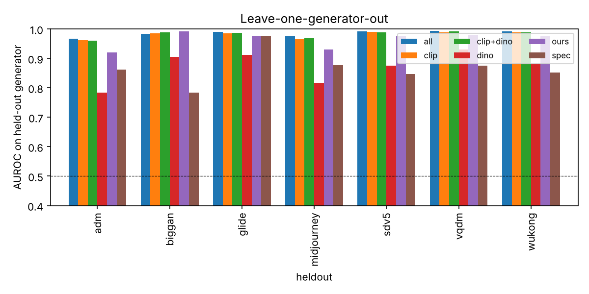

# fake-image-generalization

How well do cheap AI-image detectors hold up on generators they've never seen, and after an image gets compressed?

## Method

I took 21,000 images from GenImage (7 generators plus matching real photos), ran each one through frozen CLIP and DINOv2 models, and trained a simple logistic regression on top. To test generalisation, I trained on 6 generators and tested on the 7th, and also tested on 9 newer generators from Synthbuster. Images were tested clean and after JPEG compression, resizing and blur. Feature extraction ran on a free Kaggle GPU; everything else runs on a laptop.

## Results

- Every real image in GenImage is a JPEG and every fake is a PNG. A detector trained on the raw files partly learns that, and its accuracy drops from 97% to 84% once everything is saved as JPEG.
- With that removed, the CLIP detector still does well on generators it never saw (AUROC around 0.98). When it fails, it misses fakes: only about 75% of Midjourney images were caught when Midjourney was left out of training.
- On the newer generators (DALL-E 3, Firefly, SDXL, Midjourney v5 and others) it catches 90% of fakes on clean images, but only 4% after saving them as JPEG at quality 50.
- A lot of that drop comes from a hidden version of the same shortcut. The real photos were already JPEGs, so after re-saving they had been compressed twice, while the fakes had been compressed once. The detector learned that heavy compression means real. Giving the fakes the same compression history as the real photos raises the JPEG-50 catch rate from 4% to 48%, with clean-image results unchanged.
- The rest is real information loss. Training on compressed and blurred copies gets it to 84%, but that mostly helps with the kinds of damage seen in training.

## Running it

The notebooks/ folder has the three Kaggle feature-extraction notebooks, the matched-compression one, and 05_analysis.ipynb, which reproduces every number above on CPU. The same code is in src/.

Caveats: a small GenImage subset, one random seed, and the Synthbuster numbers only count fakes caught, since its real photos aren't on Kaggle.
